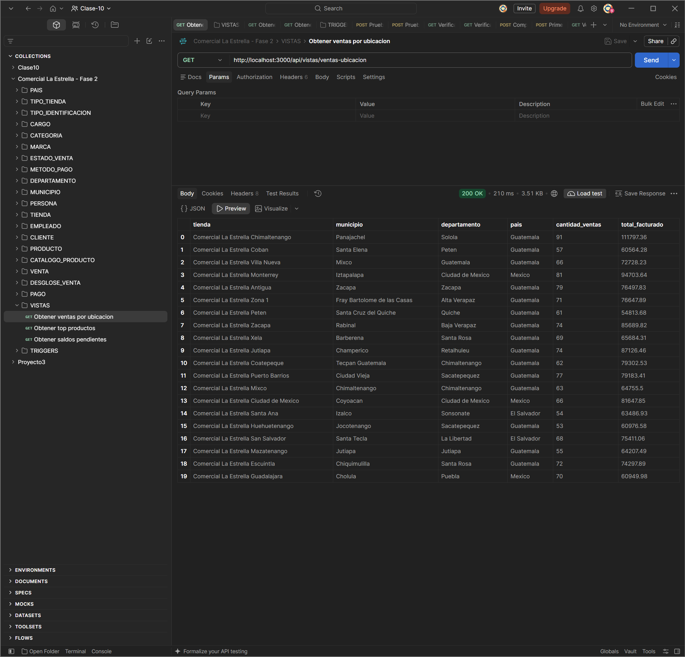
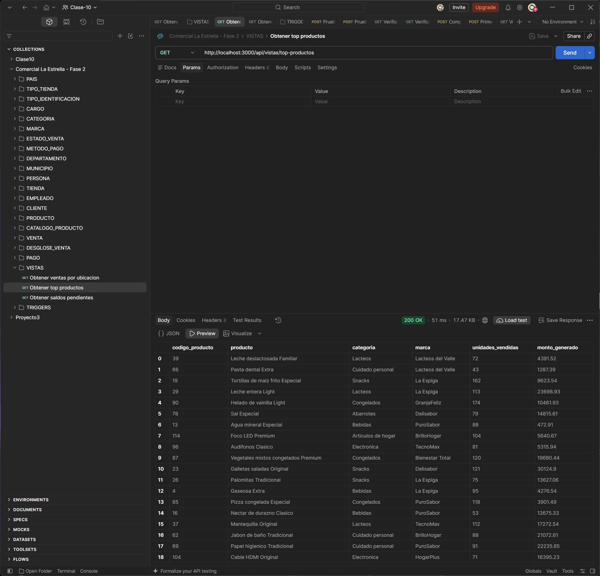
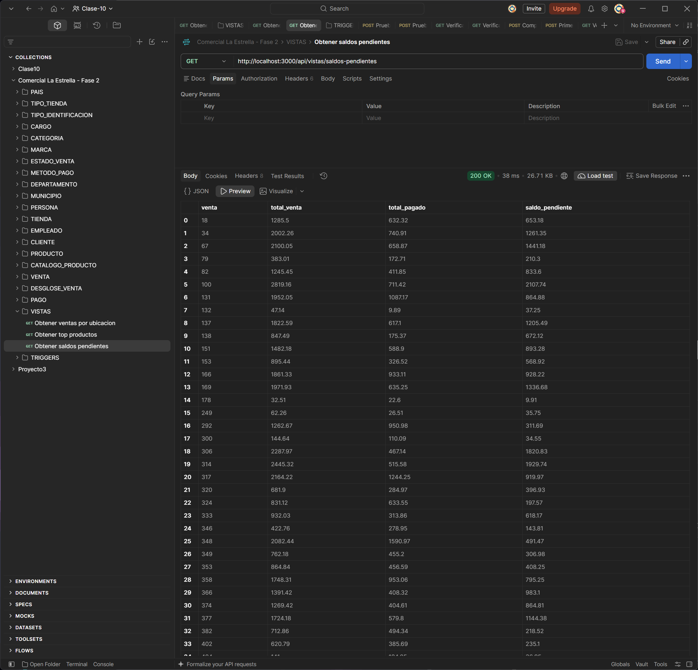
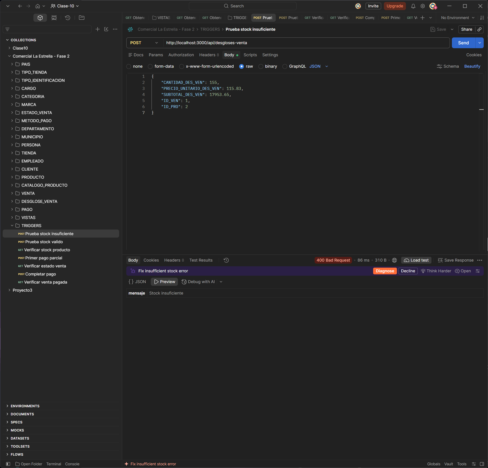
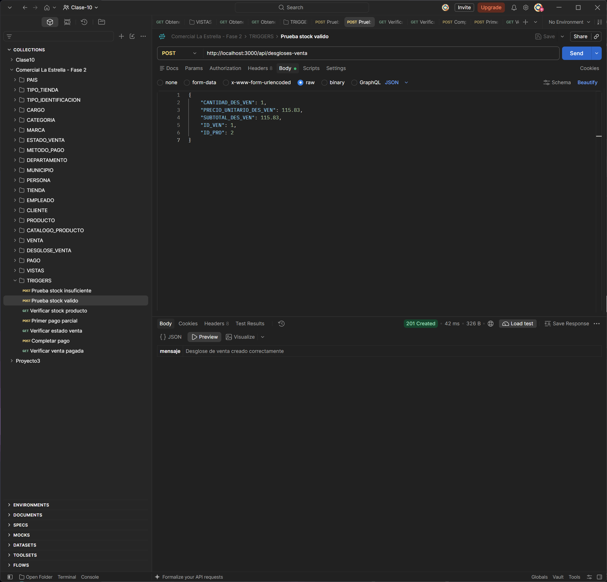
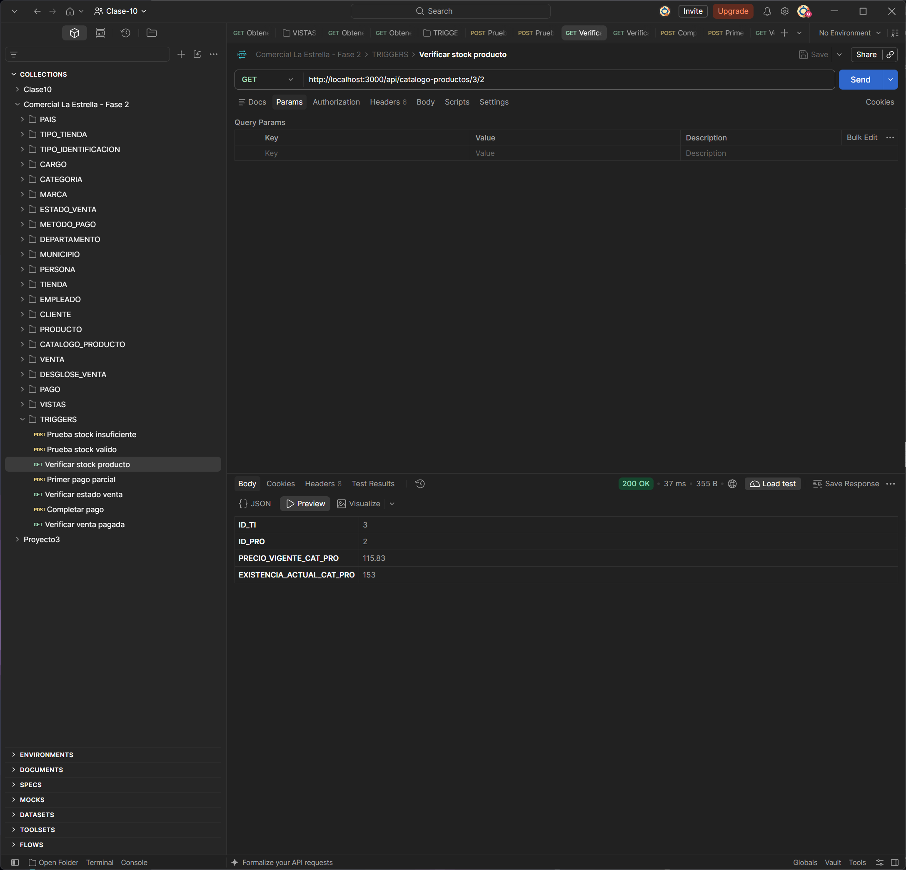
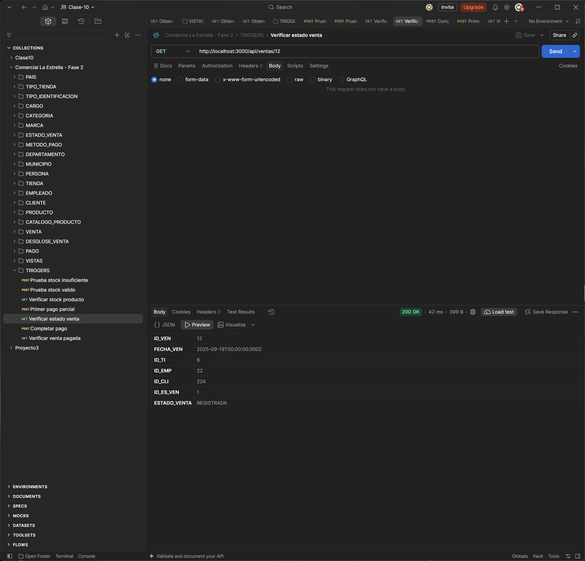
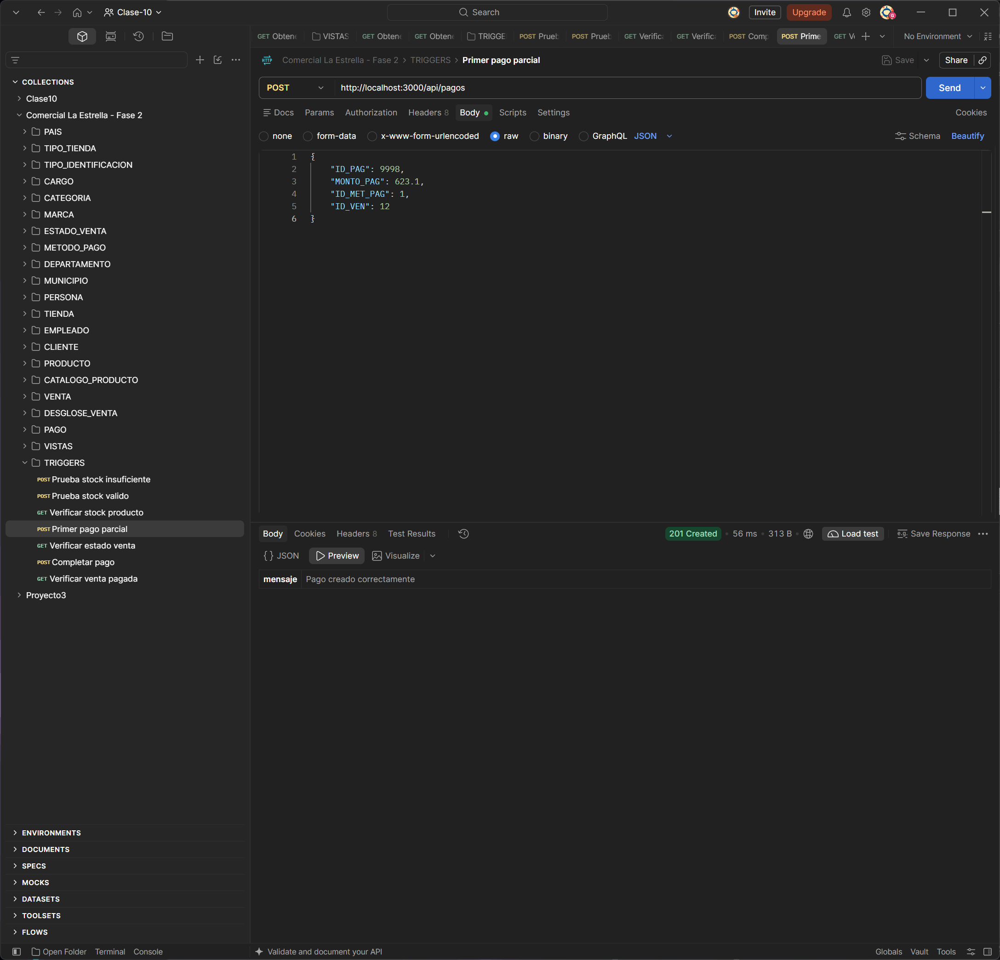
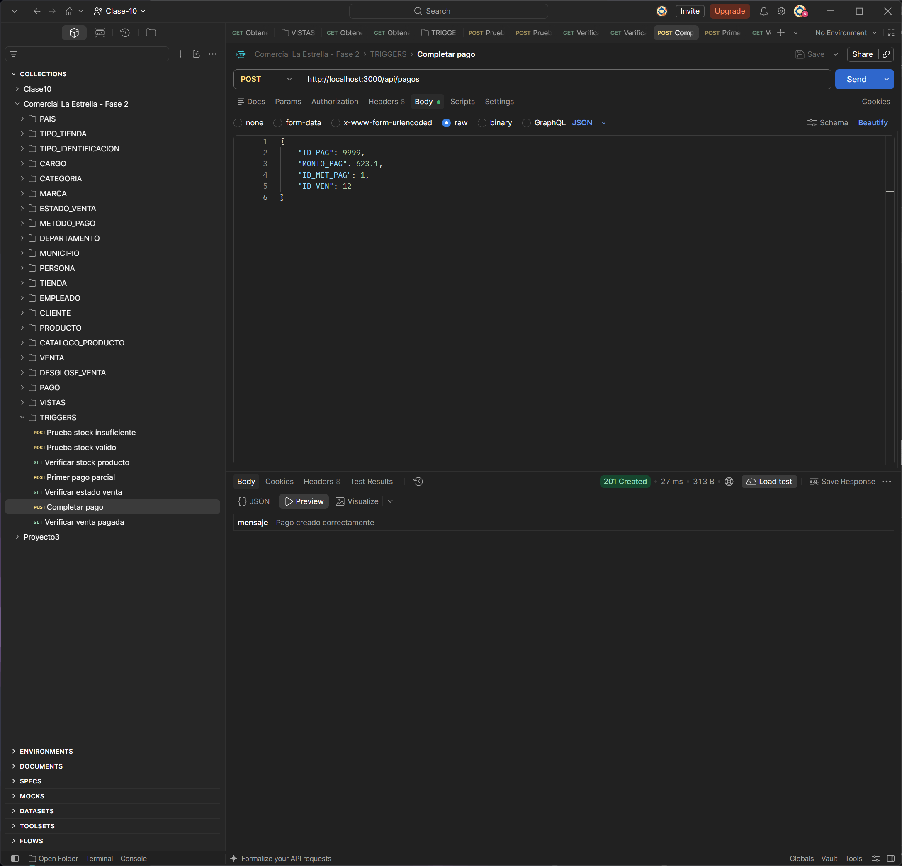
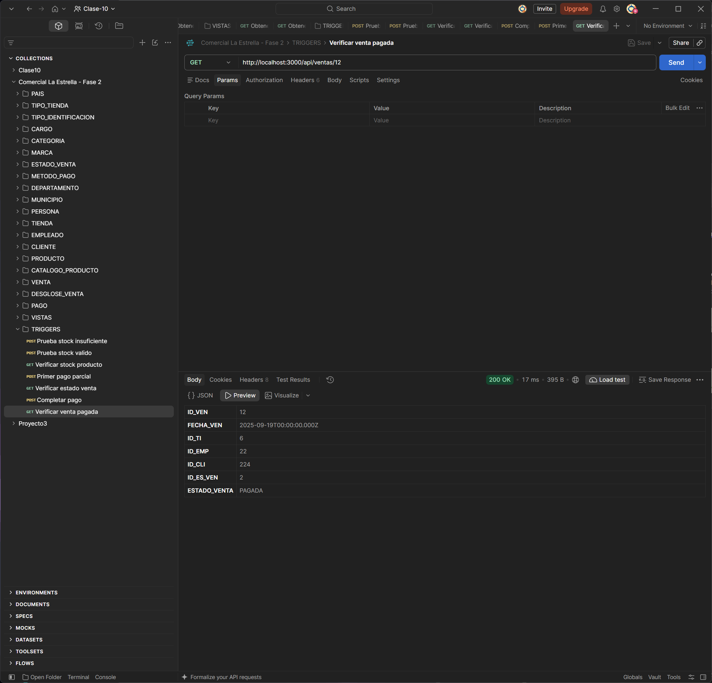

# Documentación del Proyecto 2
## Comercial La Estrella

**Curso:** Bases de Datos 1  
**Proyecto:** Fase 2  
**Nombre:** Yury Urbano Santos Chagil
**Carne:** 202113318  


---

## 1. Descripción general

El proyecto **Comercial La Estrella** implementa una base de datos relacional para administrar información de tiendas, clientes, empleados, productos, inventario, ventas y pagos.

En la Fase 2 se utilizó **SQL Server 2022 ejecutado en Docker** y se desarrolló una **API REST con Node.js y Express**. Las operaciones de inserción, actualización y eliminación se realizan mediante la API.

El proyecto incluye:

- 19 tablas.
- CRUD completo para las 19 entidades.
- Carga del dataset mediante la API REST.
- 3 vistas SQL.Documentacion_Proyecto2_Comercial_La_Estrella
- 2 triggers.
- Pruebas en Postman.
- Scripts de verificación.
- Inicialización automática con Docker Compose e `init.sql`.

---

## 2. Objetivos

### 2.1 Objetivo general

Implementar una solución de base de datos para Comercial La Estrella utilizando SQL Server 2022, Docker y una API REST desarrollada con Node.js.

### 2.2 Objetivos específicos

- Crear la estructura relacional del sistema en SQL Server.
- Implementar integridad mediante PK, FK, restricciones `UNIQUE` y `CHECK`.
- Desarrollar CRUD para las 19 tablas.
- Cargar el dataset por medio de la API.
- Crear vistas SQL para consultas específicas.
- Implementar triggers para inventario y pagos.
- Dockerizar SQL Server.
- Validar la carga de datos, inventario y estados de venta.
- Documentar instalación, ejecución y pruebas.

---

## 3. Tecnologías utilizadas

| Tecnología | Uso |
|---|---|
| SQL Server 2022 | Motor de base de datos |
| Docker Desktop | Ejecución de contenedores |
| Docker Compose | Orquestación e inicialización |
| Node.js | Backend |
| Express | API REST |
| `mssql` | Conexión con SQL Server |
| `dotenv` | Variables de entorno |
| `cors` | Configuración de acceso a la API |
| `xlsx` | Lectura del dataset |
| Nodemon | Desarrollo |
| Postman | Pruebas de endpoints |
| DBeaver | Verificación estructural y consultas de solo lectura |

---

## 4. Arquitectura

```text
┌─────────────────┐
│     Postman     │
│ Cliente REST API│
└────────┬────────┘
         │ HTTP / JSON
         ▼
┌─────────────────┐
│ Node.js/Express │
│    REST API     │
└────────┬────────┘
         │ mssql
         ▼
┌─────────────────┐
│ SQL Server 2022 │
│     Docker      │
└─────────────────┘
```

---

## 5. Estructura general del proyecto

```text
ProyectoFase2_Comercial_La_Estrella/
│
├── capturas/
│   ├── 01_Vista_Ventas_Ubicacion.png
│   ├── 02_Vista_Top_Productos.png
│   ├── 03_Vista_Saldos_Pendientes.png
│   ├── 04_Stock_Insuficiente.png
│   ├── 05_Prueba_Stock_Valido.png
│   ├── 06_Verificar_Stock_Producto.png
│   ├── 07_Estado_Venta_Inicial.png
│   ├── 08_Primer_Pago_Parcial.png
│   ├── 09_Estado_Despues_Primer_Pago.png
│   ├── 10_Completar_Pago.png
│   └── 11_Verificar_Venta_Pagada.png
│
├── data/
│   └── dataset_comercial_la_estrella.xlsx
│
├── scripts/
│   ├── cargarDataset.js
│   ├── verificarCarga.js
│   ├── verificarInventario.js
│   ├── verificarEstadosVentas.js
│   └── buscarPruebaTriggerPago.js
│
├── src/
│   ├── config/
│   │   └── database.js
│   ├── controllers/
│   ├── routes/
│   └── app.js
│
├── .env
├── .gitignore
├── Comercial_La_Estrella_Fase2.postman_collection.json
├── docker-compose.yml
├── init.sql
├── package.json
└── package-lock.json
```

> `node_modules/` no debe incluirse en una entrega o repositorio, ya que puede reconstruirse con `npm install`.

---

## 6. Base de datos

La base de datos se denomina:

```text
COMERCIAL_LA_ESTRELLA
```

Contiene 19 tablas:

1. `PAIS`
2. `TIPO_TIENDA`
3. `TIPO_IDENTIFICACION`
4. `CARGO`
5. `CATEGORIA`
6. `MARCA`
7. `ESTADO_VENTA`
8. `METODO_PAGO`
9. `DEPARTAMENTO`
10. `MUNICIPIO`
11. `PERSONA`
12. `TIENDA`
13. `EMPLEADO`
14. `CLIENTE`
15. `PRODUCTO`
16. `CATALOGO_PRODUCTO`
17. `VENTA`
18. `DESGLOSE_VENTA`
19. `PAGO`

---

## 7. Relaciones principales

- `PAIS` 1:N `DEPARTAMENTO`.
- `DEPARTAMENTO` 1:N `MUNICIPIO`.
- `MUNICIPIO` 1:N `PERSONA`.
- `MUNICIPIO` 1:N `TIENDA`.
- `TIPO_TIENDA` 1:N `TIENDA`.
- `PERSONA` 1:1 `EMPLEADO`.
- `PERSONA` 1:1 `CLIENTE`.
- `CARGO` 1:N `EMPLEADO`.
- `CATEGORIA` 1:N `PRODUCTO`.
- `MARCA` 1:N `PRODUCTO`.
- `TIENDA` N:M `PRODUCTO` mediante `CATALOGO_PRODUCTO`.
- `VENTA` se relaciona con tienda, empleado, cliente y estado.
- `VENTA` N:M `PRODUCTO` mediante `DESGLOSE_VENTA`.
- `VENTA` 1:N `PAGO`.

---

## 8. Integridad de datos

La base utiliza:

- Llaves primarias.
- Llaves foráneas.
- Restricciones `UNIQUE`.
- Restricciones `CHECK`.
- Índices únicos.

Las tablas `CATALOGO_PRODUCTO` y `DESGLOSE_VENTA` utilizan llaves primarias compuestas.

Entre las validaciones se incluyen:

- Precio mayor que cero.
- Existencia mayor o igual que cero.
- Cantidad vendida mayor que cero.
- Monto de pago mayor que cero.
- Subtotal consistente con cantidad por precio unitario.

Para `PERSONA.CORREO_PER` se utiliza un índice único filtrado, permitiendo valores `NULL` pero evitando correos repetidos.

---

## 9. Dockerización

El archivo principal es:

```text
docker-compose.yml
```

Se utiliza la imagen:

```text
mcr.microsoft.com/mssql/server:2022-latest
```

SQL Server se expone mediante el puerto:

```text
1433
```

También se utiliza un volumen persistente para `/var/opt/mssql`.

El servicio `sqlserver_init` espera a que SQL Server esté disponible y ejecuta automáticamente:

```text
init.sql
```

El script crea:

- La base de datos.
- Las 19 tablas.
- Restricciones e índices.
- Las tres vistas.
- Los dos triggers.

### Iniciar los contenedores

```bash
docker compose up -d
```

### Revisar inicialización

```bash
docker compose logs sqlserver_init
```

Salida esperada:

```text
SQL Server listo.
Ejecutando init.sql...
Base de datos COMERCIAL_LA_ESTRELLA inicializada.
19 tablas creadas correctamente.
Inicializacion terminada.
```

### Reconstrucción completa

```bash
docker compose down -v
docker compose up -d
```

---

## 10. Configuración del backend

El archivo `.env` contiene las variables necesarias para conectarse a SQL Server.

Ejemplo:

```env
PORT=3000
DB_SERVER=localhost
DB_PORT=1433
DB_DATABASE=COMERCIAL_LA_ESTRELLA
DB_USER=sa
DB_PASSWORD=<contraseña-configurada>
```

La conexión se implementa en:

```text
src/config/database.js
```

---

## 11. Instalación y ejecución

### Instalar dependencias

```bash
npm install
```

### Ejecutar la API en desarrollo

```bash
npm run dev
```

Salida esperada:

```text
Servidor ejecutándose en http://localhost:3000
Conexión a SQL Server establecida correctamente
```

También puede utilizarse:

```bash
npm start
```

---

## 12. Prueba de conexión

Endpoint:

```http
GET http://localhost:3000/api/test-db
```

Respuesta esperada:

```json
{
  "mensaje": "Conexión con SQL Server correcta",
  "base_datos": "COMERCIAL_LA_ESTRELLA",
  "total_tablas": 19
}
```

---

## 13. API REST

Se implementó CRUD para las 19 entidades.

| Entidad | Endpoint base |
|---|---|
| PAIS | `/api/paises` |
| TIPO_TIENDA | `/api/tipos-tienda` |
| TIPO_IDENTIFICACION | `/api/tipos-identificacion` |
| CARGO | `/api/cargos` |
| CATEGORIA | `/api/categorias` |
| MARCA | `/api/marcas` |
| ESTADO_VENTA | `/api/estados-venta` |
| METODO_PAGO | `/api/metodos-pago` |
| DEPARTAMENTO | `/api/departamentos` |
| MUNICIPIO | `/api/municipios` |
| PERSONA | `/api/personas` |
| TIENDA | `/api/tiendas` |
| EMPLEADO | `/api/empleados` |
| CLIENTE | `/api/clientes` |
| PRODUCTO | `/api/productos` |
| CATALOGO_PRODUCTO | `/api/catalogo-productos` |
| VENTA | `/api/ventas` |
| DESGLOSE_VENTA | `/api/desgloses-venta` |
| PAGO | `/api/pagos` |

Operaciones generales:

```http
GET    /api/recurso
POST   /api/recurso
GET    /api/recurso/:id
PUT    /api/recurso/:id
DELETE /api/recurso/:id
```

Entidades con llave compuesta:

```http
GET    /api/catalogo-productos/:idTienda/:idProducto
PUT    /api/catalogo-productos/:idTienda/:idProducto
DELETE /api/catalogo-productos/:idTienda/:idProducto
```

```http
GET    /api/desgloses-venta/:idVenta/:idProducto
PUT    /api/desgloses-venta/:idVenta/:idProducto
DELETE /api/desgloses-venta/:idVenta/:idProducto
```

---

## 14. Carga del dataset

El dataset se encuentra en:

```text
data/dataset_comercial_la_estrella.xlsx
```

La carga se ejecuta con:

```bash
node scripts/cargarDataset.js
```

La carga se realiza mediante solicitudes HTTP a la API REST en un orden que respeta las llaves foráneas.

Orden:

```text
PAIS
TIPO_TIENDA
TIPO_IDENTIFICACION
CARGO
CATEGORIA
MARCA
ESTADO_VENTA
METODO_PAGO
DEPARTAMENTO
MUNICIPIO
PERSONA
TIENDA
EMPLEADO
CLIENTE
PRODUCTO
CATALOGO_PRODUCTO
VENTA
DESGLOSE_VENTA
PAGO
```

---

## 15. Registros cargados

| Tabla | Registros |
|---|---:|
| PAIS | 3 |
| TIPO_TIENDA | 4 |
| TIPO_IDENTIFICACION | 3 |
| CARGO | 4 |
| CATEGORIA | 10 |
| MARCA | 15 |
| ESTADO_VENTA | 3 |
| METODO_PAGO | 4 |
| DEPARTAMENTO | 32 |
| MUNICIPIO | 80 |
| PERSONA | 388 |
| TIENDA | 20 |
| EMPLEADO | 88 |
| CLIENTE | 300 |
| PRODUCTO | 114 |
| CATALOGO_PRODUCTO | 1424 |
| VENTA | 1500 |
| DESGLOSE_VENTA | 3687 |
| PAGO | 1389 |
| **TOTAL** | **9068** |

---

## 16. Verificación de carga

Comando:

```bash
node scripts/verificarCarga.js
```

Resultado final:

```text
TOTAL EN API: 9068
TOTAL ESPERADO: 9068

CARGA VERIFICADA CORRECTAMENTE
```

---

## 17. Verificación de inventario

Comando:

```bash
node scripts/verificarInventario.js
```

Resultado:

```text
Registros correctos: 1424
Diferencias: 0
Total revisado: 1424

INVENTARIO VERIFICADO CORRECTAMENTE
```

Esto confirma que el inventario final coincide con el dataset.

---

## 18. Verificación de estados de venta

Comando:

```bash
node scripts/verificarEstadosVentas.js
```

Resultado:

```text
Ventas correctas: 1500
Diferencias: 0
Total revisado: 1500
```

Distribución:

```text
REGISTRADA = 342
PAGADA     = 1021
ANULADA    = 137
```

---

## 19. Vista SQL: Vista_Ventas_Ubicacion

Permite consultar ventas agrupadas según la ubicación de la tienda.

Incluye:

- Tienda.
- Municipio.
- Departamento.
- País.
- Cantidad de ventas.
- Total facturado.

Las ventas anuladas no se incluyen en la facturación.

Endpoint:

```http
GET http://localhost:3000/api/vistas/ventas-ubicacion
```

### Evidencia en Postman

La siguiente captura muestra la ejecución correcta del endpoint y los resultados obtenidos desde la vista `Vista_Ventas_Ubicacion`.



*Figura 1. Resultado de la vista Vista_Ventas_Ubicacion en Postman.*

---

## 20. Vista SQL: Vista_Top_Productos

Presenta información sobre el desempeño de los productos.

Incluye:

- Código de producto.
- Producto.
- Categoría.
- Marca.
- Unidades vendidas.
- Monto generado.

Endpoint:

```http
GET http://localhost:3000/api/vistas/top-productos
```

### Evidencia en Postman

La siguiente captura muestra el resultado devuelto por `Vista_Top_Productos`, incluyendo las unidades vendidas y el monto generado por producto.



*Figura 2. Resultado de la vista Vista_Top_Productos en Postman.*

---

## 21. Vista SQL: Vista_Saldos_Pendientes

Muestra ventas con saldo pendiente.

Incluye:

- Venta.
- Total de venta.
- Total pagado.
- Saldo pendiente.

Endpoint:

```http
GET http://localhost:3000/api/vistas/saldos-pendientes
```

### Evidencia en Postman

La siguiente captura evidencia los resultados de la vista `Vista_Saldos_Pendientes`, mostrando el total de la venta, el total pagado y el saldo pendiente.



*Figura 3. Resultado de la vista Vista_Saldos_Pendientes en Postman.*

---

## 22. Trigger Insert_Detalle

El trigger `Insert_Detalle` se ejecuta después de insertar en `DESGLOSE_VENTA`.

Funciones:

1. Verificar que exista suficiente inventario.
2. Descontar automáticamente la cantidad vendida.

### 22.1 Prueba de stock insuficiente

Se utilizó un producto con existencia de 154 unidades y se intentaron vender 155.

Resultado:

```json
{
  "mensaje": "Stock insuficiente"
}
```

El API devuelve un error `400 Bad Request` y el registro no es insertado.



*Figura 4. El trigger rechaza la inserción porque la cantidad solicitada supera la existencia disponible.*

### 22.2 Prueba con stock válido

Posteriormente se insertó una cantidad válida de una unidad. La API respondió correctamente y permitió registrar el detalle.



*Figura 5. Inserción válida de un detalle de venta.*

### 22.3 Verificación de disminución de inventario

Después de la inserción válida se consultó el producto inmediatamente mediante la API.

Resultado:

```text
Existencia antes: 154
Existencia después: 153
```



*Figura 6. Verificación de la disminución automática del inventario de 154 a 153 unidades.*

La disminución fue realizada automáticamente por el trigger `Insert_Detalle`.

---

## 23. Trigger Insert_Pago

El trigger `Insert_Pago` acumula los pagos asociados a una venta.

Cuando el monto acumulado cubre o supera el total de la venta, cambia automáticamente el estado a `PAGADA`.

Prueba realizada:

```text
Venta: 12
Total: 1246.20
Estado inicial: ID_ES_VEN = 1
ESTADO_VENTA = REGISTRADA
```

### 23.1 Estado inicial de la venta

Antes de registrar los pagos, la venta se encuentra en estado `REGISTRADA`.



*Figura 7. Estado inicial de la venta 12: REGISTRADA.*

### 23.2 Primer pago parcial

Se registró un primer abono por:

```text
623.10
```



*Figura 8. Registro exitoso del primer pago parcial.*

Después del primer abono, el monto acumulado todavía no cubre el total de la venta. Al consultar nuevamente la venta, el estado permanece en:

```text
ID_ES_VEN = 1
ESTADO_VENTA = REGISTRADA
```


*Figura 9. La venta permanece REGISTRADA después del primer pago parcial.*

### 23.3 Segundo pago y actualización automática

Se registró un segundo pago por:

```text
623.10
```



*Figura 10. Registro exitoso del pago que completa el total de la venta.*

Total acumulado:

```text
623.10 + 623.10 = 1246.20
```

Al consultar nuevamente la venta, el trigger actualizó automáticamente el estado:

```text
ID_ES_VEN = 2
ESTADO_VENTA = PAGADA
```



*Figura 11. La venta cambia automáticamente a PAGADA después de completar el monto total.*

---

## 24. Colección de Postman

Archivo:

```text
Comercial_La_Estrella_Fase2.postman_collection.json
```

Formato:

```text
Postman Collection v2.1
```

La colección exportada contiene:

```text
105 requests
21 folders
```

Incluye:

- 19 carpetas CRUD.
- Carpeta `VISTAS`.
- Carpeta `TRIGGERS`.

### Carpeta VISTAS

```text
GET Obtener ventas por ubicacion
GET Obtener top productos
GET Obtener saldos pendientes
```

### Carpeta TRIGGERS

Incluye escenarios como:

```text
POST Prueba stock insuficiente
POST Prueba stock valido
GET  Verificar stock producto
POST Primer pago parcial
GET  Verificar estado venta
POST Completar pago
GET  Verificar venta pagada
```

Las solicitudes que realizan `POST`, `PUT` o `DELETE` modifican la base de datos y deben utilizarse sobre un entorno preparado para pruebas.

---

## 25. Uso de DBeaver

DBeaver se utiliza únicamente para:

- Verificar tablas.
- Revisar restricciones.
- Consultar vistas.
- Revisar triggers.
- Realizar consultas de solo lectura.

Las operaciones de manipulación de datos se realizan mediante la API REST.

---

## 26. Procedimiento de ejecución desde cero

### Paso 1. Abrir la raíz del proyecto

```bash
cd C:\ProyectoFase2_Comercial_La_Estrella
```

### Paso 2. Instalar dependencias

```bash
npm install
```

### Paso 3. Levantar SQL Server

```bash
docker compose up -d
```

### Paso 4. Revisar inicialización

```bash
docker compose logs sqlserver_init
```

### Paso 5. Iniciar la API

```bash
npm run dev
```

### Paso 6. Probar conexión

```http
GET http://localhost:3000/api/test-db
```

### Paso 7. Cargar dataset

```bash
node scripts/cargarDataset.js
```

### Paso 8. Verificar carga

```bash
node scripts/verificarCarga.js
```

### Paso 9. Verificar inventario

```bash
node scripts/verificarInventario.js
```

### Paso 10. Verificar estados

```bash
node scripts/verificarEstadosVentas.js
```

### Paso 11. Importar Postman

Importar:

```text
Comercial_La_Estrella_Fase2.postman_collection.json
```

---

## 27. Restablecimiento de la base después de pruebas

Si las pruebas modifican datos y se desea regresar exactamente al dataset original:

```bash
docker compose down -v
docker compose up -d
```

Después:

```bash
npm run dev
```

En otra terminal:

```bash
node scripts/cargarDataset.js
```

Finalmente:

```bash
node scripts/verificarCarga.js
node scripts/verificarInventario.js
node scripts/verificarEstadosVentas.js
```

El resultado esperado es:

```text
9068 registros
0 diferencias de inventario
0 diferencias de estados de venta
```

---

## 28. Resultados finales

| Validación | Resultado |
|---|---|
| Tablas | 19 |
| CRUD completos | 19 |
| Registros cargados | 9068 |
| Registros esperados | 9068 |
| Inventarios revisados | 1424 |
| Diferencias de inventario | 0 |
| Ventas revisadas | 1500 |
| Diferencias de estados | 0 |
| Vistas SQL | 3 |
| Triggers | 2 |
| Colección Postman | Exportada |
| Formato Postman | v2.1 |
| Requests en Postman | 105 |
| Carpetas en Postman | 21 |

---

## 29. Conclusiones

La Fase 2 de **Comercial La Estrella** implementa una solución completa utilizando SQL Server 2022, Docker y una API REST.

Docker permite reproducir el entorno de base de datos y ejecutar automáticamente `init.sql`. La API REST centraliza las operaciones CRUD de las 19 entidades y permite realizar la manipulación de información sin depender de herramientas gráficas.

Las tres vistas facilitan la consulta de ventas por ubicación, productos y saldos pendientes. Los triggers implementan reglas de negocio directamente en SQL Server: control de inventario y actualización del estado de una venta según sus pagos.

Las verificaciones realizadas confirmaron la carga correcta de los **9068 registros**, con **0 diferencias de inventario** y **0 diferencias en los estados de venta**.

---